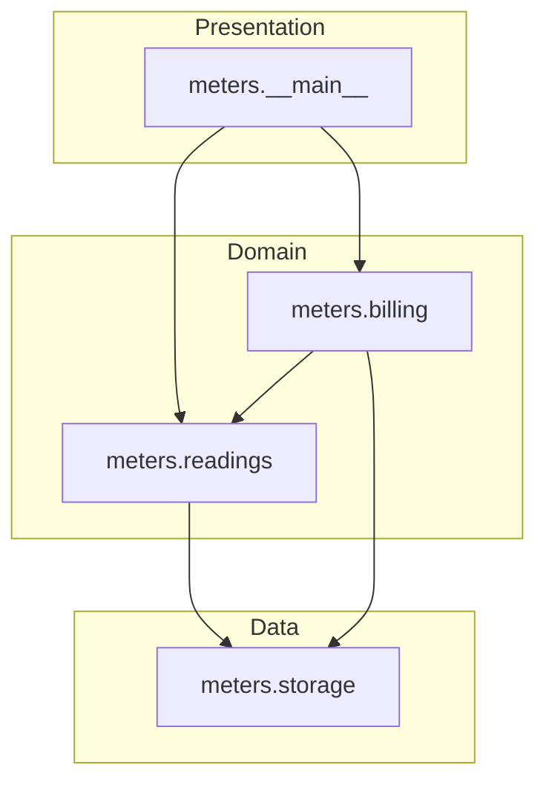

# Архітектура

Консольний продукт «Облік показників лічильників». Три шари: presentation → domain → data. Викликати можна тільки «вниз».

## Модулі й контракти

| Модуль             | Шар          | Операції контракту                                                                                             |
|--------------------|--------------|----------------------------------------------------------------------------------------------------------------|
| `meters.__main__`  | presentation | `main(argv)` — розібрати команду користувача, викликати домен, надрукувати результат                           |
| `meters.readings`  | domain       | `add(лічильник, значення, дата)` — додати показник; `consumption(лічильник, місяць)` — споживання за місяць    |
| `meters.billing`   | domain       | `bill(місяць, тариф)` — сума до сплати; `anomalies()` — підозрілі показники                                    |
| `meters.storage`   | data         | `load()` — отримати всі записи; `save(записи)` — замінити записи                                               |

Дозволені виклики: `__main__` → `readings`, `billing`; `billing` → `readings`, `storage`; `readings` → `storage`.
Заборонено: `__main__` → `storage` (презентація не торкається даних), будь-який виклик «вгору».

## Порушення межі, знайдене в коді

У коміті `3b26587` модуль `billing` знав, **як і де** зберігаються дані, хоча це справа лише модуля даних:

- `meters/billing.py#L13-L17` — власна функція `_load()` сама перевіряє наявність сховища, відкриває його і розбирає вміст;
- `meters/billing.py#L14` і `#L16` — шлях до сховища береться з `readings.data_path()`, тобто `billing` залежить від того, що `readings` зберігає шлях у себе;
- `meters/readings.py#L11-L15` — така сама логіка вдруге, у `readings._load()`.

Наслідок: зміна способу зберігання (інший формат, інше місце) зачіпає два модулі домену, і їх легко розсинхронізувати.
Перегляд: `git show 3b26587:meters/billing.py`.

Рішення — [ADR-0001](adr/0001-vydilyty-storage.md): винести все в `meters.storage`.
